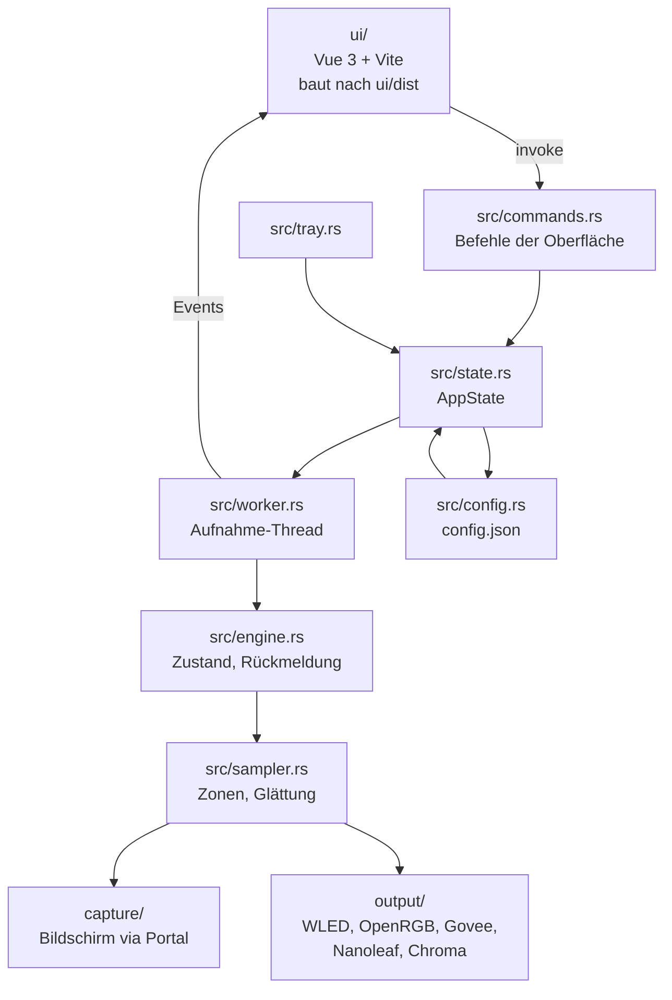

# Architektur

Stand 2026-11-02. Diese Datei beschreibt den Aufbau und die Grenzen; die Details
stehen in den Modulköpfen des Quelltexts.

## Zuschnitt

Ein Crate (`wled-ambilight`) mit Kern **und** Tauri-Host, ein Frontend (`ui/`,
Vue 3 + Vite). Der Kern ist eine Bibliothek (`src/lib.rs`), damit Tests und
Oberfläche dieselbe Logik benutzen; das Fenster ist nur die Hülle.

## Grenzen

- **Die Oberfläche kennt keine Domäne.** Sie spricht nur Befehle (`invoke`) und
  empfängt Ereignisse; gerechnet wird in Rust. Ein Zustand, den das Frontend
  führt, kommt aus dem Modell — nicht aus einer eigenen Kopie.
- **Aufnahme und Ausgabe laufen in einem eigenen Thread.** Die Oberfläche darf
  nie auf das Portal oder ein Gerät warten; der Worker meldet Fortschritt als
  Ereignis.
- **Konfiguration ist eine Datei.** `config.json` ist die einzige Wahrheit für
  Geräte, Zonen und Einstellungen; sie wird beim Ändern geschrieben, nicht beim
  Beenden gesammelt.
- **Plattformunterschiede sind Daten.** Aufnahme (Portal, Windows Graphics
  Capture, CoreGraphics) und Tray liegen hinter `cfg`-Modulen, aber die
  Oberfläche sieht davon nichts.

## Abhängigkeiten

`ui/` → Tauri-Befehle → `state`/`engine`/`sampler`/`capture`/`output` →
`config`. Keine Rückrichtung außer über Ereignisse.
