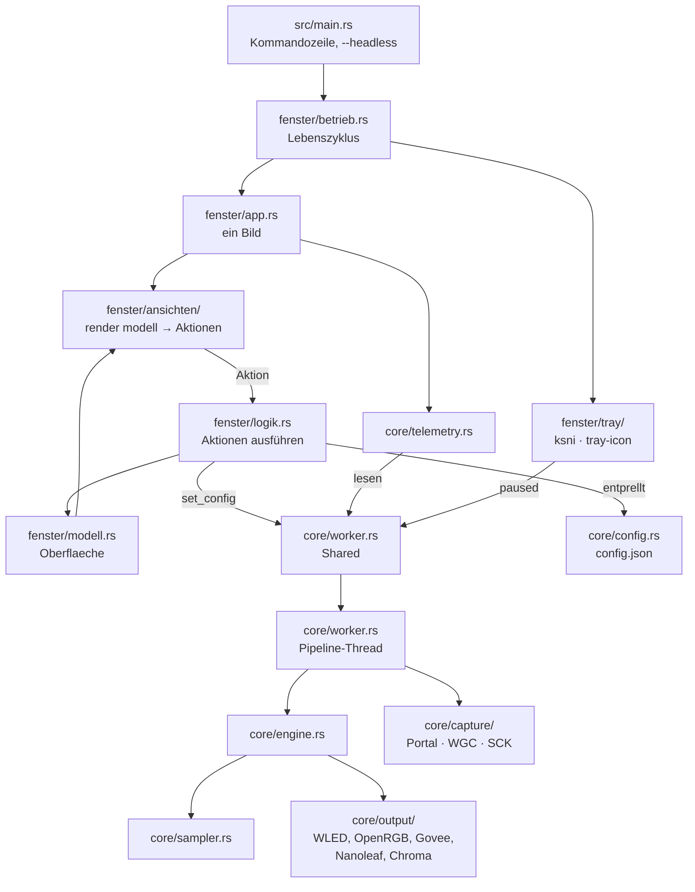

# Architektur

Stand 2026-11-21. Diese Datei beschreibt den Aufbau und die Grenzen; die Details
stehen in den Modulköpfen des Quelltexts.

## Zuschnitt

Reines Rust, ein Prozess, drei Pakete in einem Workspace
([ADR 0001](adr/0001-fenster-in-egui.md)):

| Paket | Pfad | Aufgabe |
|---|---|---|
| `wled-ambilight-core` (Bibliothek `wled_ambilight`) | `crates/core` | Aufnahme, Sampling, Engine, Ausgabe, Konfiguration, Telemetrie – keine Oberfläche |
| `wled-ambilight-fenster` | `crates/fenster` | das Fenster in egui: Modell, Logik, Ansichten, Bausteine, Themes, Tray |
| `wled-ambilight` | `src/main.rs` | Kommandozeile, Betrieb ohne Fenster (`--headless`) |

## Grenzen

- **Richtung der Abhängigkeiten:** `core ← fenster ← wled-ambilight`. Der Kern
  kennt kein egui; alles dort ist ohne Fenster testbar.
- **Eine Wahrheit.** Die Pipeline hält die gültige Konfiguration (`Shared`).
  Das Fenster bearbeitet eine Fassung davon im Modell (`Oberflaeche::config`)
  und gibt jede Änderung sofort mit `Shared::set_config` zurück; auf die Platte
  geht sie entprellt (300 ms). Der Portal-Token gehört der Pipeline.
- **`render(modell) → Aktionen`.** Die Ansichten lesen nur; jede Bedienung wird
  zur `Aktion`, `logik::ausfuehren` führt sie aus. Sichtbarkeit folgt aus dem
  Modell (`Option<GeraetDialog>`, `Suche`, `Reiter`), nicht aus Anweisungen.
- **Netzwerkarbeit blockiert nie das Fenster.** Suche, Prüfen, Paaren und
  OpenRGB laufen über den Trait `logik::Netz` in Threads und melden sich als
  `Antwort` zurück. Tests setzen eine Attrappe ein.
- **Aufnahme und Ausgabe laufen im Pipeline-Thread.** Das Fenster wartet nie
  auf das Portal oder ein Gerät.
- **Plattformunterschiede sind Daten.** Die Aufnahme liegt hinter `cfg`-Modulen
  im Kern; das Fenster bekommt nur `app::Plattform` (nimmt sich die Aufnahme
  selbst aus? kann die App den Monitor wählen?). Unter Linux friert das
  Fenster im Hintergrund ein, damit es sich nicht selbst aufnimmt.
- **Tray:** ksni unter Linux (eigener Thread, überdauert das Fenster), tray-icon
  unter Windows/macOS (im Hauptthread, braucht die laufende
  Ereignisschleife). Beim Autostart (`--minimized`) schließt das Fenster unter
  Linux wirklich und öffnet sich auf „Fenster zeigen“ neu; unter Windows/macOS
  wird es minimiert.

## Gestaltung

Farben, Größen und Abstände stehen in `crates/fenster/tokens/*.tokens.json`;
`build.rs` macht daraus Konstanten. Drei Themes (dark, light, mono), Farben aus
dem Logo ([ADR 0002](adr/0002-logo-als-svg.md)). `thema::tests` prüfen die
Kontraste (WCAG) und dass Logo und Tokens dieselben Farben tragen.

## Tests

| Ebene | Wo |
|---|---|
| Kern (Pakete, Zonen, Engine, Ausgabe mit Attrappen-Servern) | `crates/core/src/**` |
| Fensterlogik (Aktionen, Ziehen, Einpassen, Suche) | `crates/fenster/src/logik.rs` |
| Fenster über AccessKit, ohne Bildschirm; Bildschirmfotos | `crates/fenster/tests/oberflaeche.rs` |
